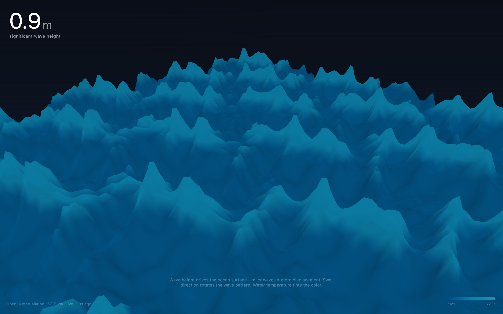
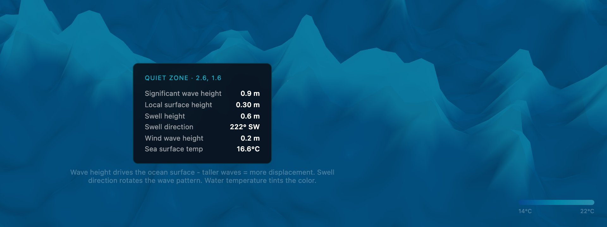

<div align="center">

<h1>tide</h1>

<p><b>San Francisco's sea, rendered live in 3D.</b></p>

<p><i>Every minute it reads the marine forecast off the city and reshapes the waves to match.</i></p>

<h6>


</h6>

<a href="https://tide.parthchandak.info"><b>Live demo</b></a> ·
<a href="#how-it-works"><b>How it works</b></a> ·
<a href="#tap-the-water"><b>Tap the water</b></a> ·
<a href="#run-it"><b>Run it</b></a>

<br><br>

<a href="https://tide.parthchandak.info"></a>

<sub>Live capture, 22 October 2026. Real forecast data, not a demo.</sub>

</div>

<br>

A single plane of 128 × 128 segments is pushed around by six Gerstner waves in a vertex shader.
How tall they are, which way they run and what colour the water is all come from the hourly
[Open-Meteo Marine](https://open-meteo.com/en/docs/marine-weather-api) forecast for the grid
point nearest 37.77° N, 122.42° W, just off San Francisco. A calm forecast flattens the
sea; a big swell raises it. No API key is needed.

## How it works

| Forecast field (current UTC hour) | Drives |
|---|---|
| `wave_height` | Wave amplitude: 0.5 to 2.5 m maps to 0.3 to 2.0 scene units, and the big number top-left |
| `swell_wave_direction` | Rotates the three long swell components |
| `wind_wave_height` | How strongly the three short chop components lean toward the wind direction |
| `wind_wave_direction` | The direction that chop leans toward |
| `sea_surface_temperature` | Water colour: deep blue at 14 °C, cyan at 18 °C, pale teal at 22 °C |

The page polls the API every 60 seconds and eases the scene toward the new values instead of
jumping. If the request fails it shows fixed fallback values (1.2 m, 16.8 °C) and the stamp in
the bottom-left says `fallback` rather than `live`.

Drag to orbit, scroll to zoom. With `prefers-reduced-motion` the surface holds still while the
numbers keep updating.

## Tap the water

<div align="center">



<sub>The panel after a click on the surface. Live data.</sub>

</div>

Click or tap anywhere on the ocean and a panel shows the full forecast for the hour, plus the
height of the surface at the point you hit, from a CPU approximation of the shader's waves. It fades after three seconds.

## Run it

```bash
git clone https://github.com/parthchandak02/tide.git
cd tide
npm install
npm run dev      # local dev server
npm run build    # static site in dist/
```

The build is a static folder with relative paths, so it deploys to any static host. The live
version runs on Cloudflare Pages.

<details>
<summary><b>Project layout</b></summary>

```
src/main.ts     Everything: config, shaders, scene, API polling, DOM overlays
index.html      Canvas host and overlay containers
brief.md        The original creative brief: concept, palette and data-to-visual encoding
vite.config.ts  Relative base path for static hosting
```

All tunables (API URL, poll interval, plane size, fog, value ranges, colours) live in the `C`
and `PALETTE` objects at the top of `src/main.ts`.

</details>

<br>

<div align="center">
<sub>Built with Three.js, TypeScript and Vite. Data from Open-Meteo Marine.</sub>
</div>
